# Planisphere

A watch face prototype for the Pebble Round 2 and Time 2: the sky as it is right now, on a planisphere.

## Plates

Like Groundtrack's plates, each plate follows a real tradition of sky charts, set in the type of its time. Every plate sets the time in hours and minutes the way almanacs and astronomers write it, **9ʰ 30ᵐ**, large in the card above the window (or **21ʰ 30ᵐ** on the 24-hour clock, below). Its figures are drawn by hand, pixel by pixel, after each plate's type and for each watch. The small type is pixel type, every letter in whole pixels: Not Jam Old Style (CC0), a pixel serif after the old Garalde faces, with star names leaning in an oblique cut from it a pixel at a time. Under it are the date in italic and the Sun's next rising or setting in small capitals, with the temperature after it when the weather is known. The sky carries names the way the old atlases letter them: constellations in spaced capitals, stars in italic, planets in small capitals.

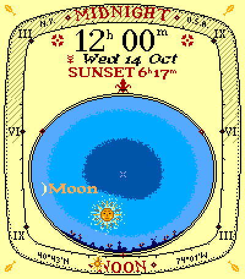

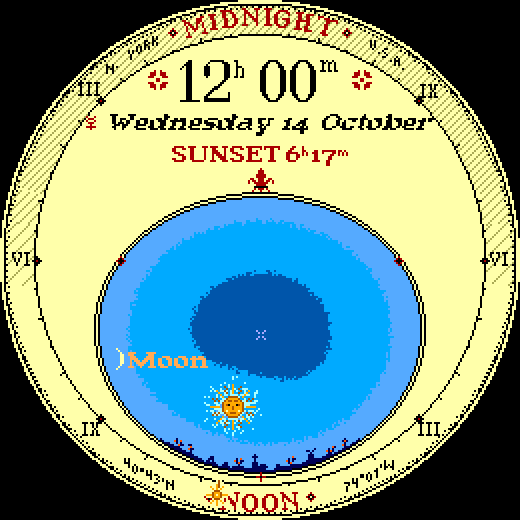

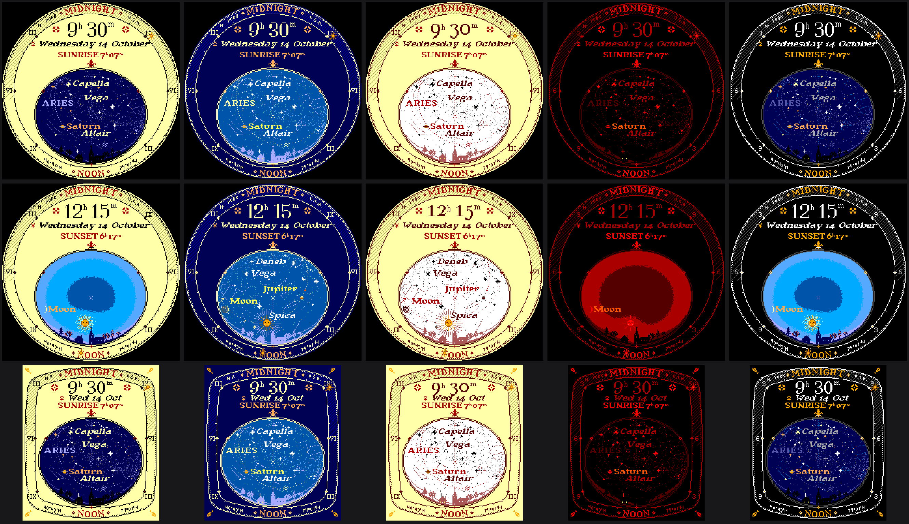

| Plate | After | Type |
| --- | --- | --- |
| **Planisphere** | The paper planispheres of the early 1900s: a cream card printed in black and red, a deep blue star disc behind its window, MIDNIGHT and NOON lettered round the ring | Old Standard, a revival of the period's scientific type |
| **Burritt** | Elijah Burritt's *Geography of the Heavens* (1835): white stars and figures on a blue ground | Playfair Display, after copperplate lettering |
| **Flamsteed** | Flamsteed's *Atlas Coelestis* (London, 1729): engraved rayed stars and figures, ink on paper, the Moon hatched | Libre Caslon: Caslon cut his type in London in the same decade |
| **Observatory** | Red light, for eyes adapted to the dark | Old Standard |
| **Night** | The first take: a black card, white type | Old Standard |

The planisphere, observatory and night plates show the live sky in their window: night blue, the blue hour with its warm glow, day blue with the Sun in it. Burritt and Flamsteed are printed atlases, so their windows keep the stars by day as a chart would, with the Sun drawn among them.

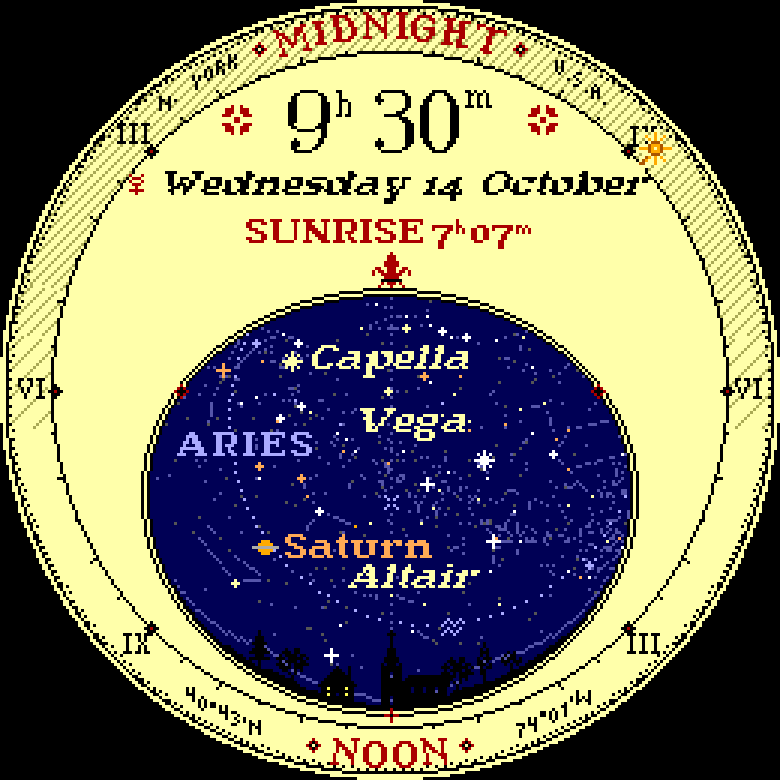

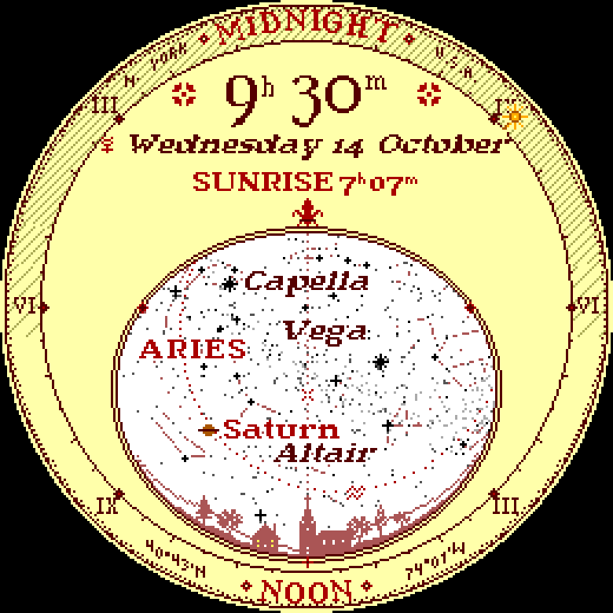

## On the Time 2, and the Round 2

The Time 2 comes first. Its ring is a cushion: arcs along the top and bottom, the sides gently bowed, the corners rounded. It fills the screen, so the window stays as large as the card allows, and MIDNIGHT and NOON still curve along it as they do round a planisphere's ring. The band is wider in the corners, its inner edge rounder than its outer, which leaves room for the hours that fall there. Each hour's tick stands where that hour's ray from the pole meets the ring, so the ticks fall unevenly round the cushion, as hour lines do on a sundial plate. Each numeral sits on its own ray, wherever it stands clearest of the rules and ticks. The four corners outside the ring each carry a sprig turning into the corner, in the season's dress: two blossoms in spring, a leaf in summer, the leaf turned gold in autumn, a bare twig in winter. On the Round 2 the ring is a circle.

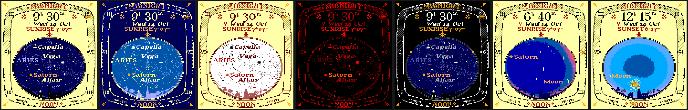

By day the Sun in the window has a face and sixteen rays, straight and flaming in turn, after the Sun of May. It stands in its own light, as the first takes drew it: a glow stippled thinner outward, the sky brightest round the Sun, white by day and warm when the Sun is low. The glow shows between the rays and past them, and draws the eye to the Sun, the hour hand. On the ring a gilded Sun hand rides the band at the Sun's own hour, as on the old astronomical clocks (Prague's Orloj, Strasbourg, Wells). A short index runs from it to the scale on the inner rule. It covers whatever it passes, as a clock's hand covers its numerals.

### The 12-hour or the 24-hour clock

The ring counts the hours as old planispheres do, twelve and twelve: III, VI and IX in the morning and again in the evening, with MIDNIGHT and NOON between. The time reads 9ʰ 30ᵐ. The 24-hour clock is an option. With it the ring's figures run on through the day (3, 6, 9, 15, 18, 21), and the time reads 21ʰ 30ᵐ, as astronomers write it. On the watch the option starts from the watch's own 12 or 24-hour setting.

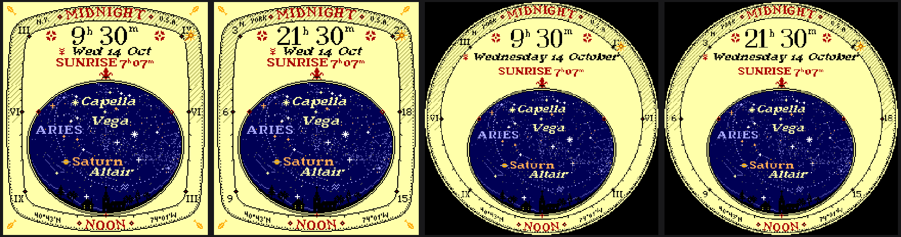

## The almanac

The face carries what an almanac page would, each thing in its old form.

- **Night on the ring.** Where the Sun's pointer will stand while the Sun is down, the band is hatched like an engraving. The hatching is sparse in civil twilight, closer through nautical and astronomical twilight, and closest in full night. You see the day's length at a glance, and the pointer walks into the hatching at sunset.
- **The day's planet.** Before the date stands the sign of the planet that rules the day, as almanacs mark their days: ☽ Monday, ♂ Tuesday, ☿ Wednesday, ♃ Thursday, ♀ Friday, ♄ Saturday, ☉ Sunday.
- **The zenith and the meridian.** A small cross marks the point straight overhead, turned on its side so it is not taken for a star. At night a dotted line runs north to south through the pole and the zenith, as on an astrolabe's plate.
- **The zodiac.** At night the signs are set along the ecliptic, each at its sign's middle, wherever no name or bright star is drawn.
- **The sky's news.** On a day with something to see, the line under the date says so in place of the sunrise or sunset:
  - an eclipse of the Sun or the Moon, if it can be seen from here;
  - two planets meeting;
  - a meteor shower's peak;
  - the Moon by a planet.

  The eclipses and the planets come from the same ephemeris as the rest of the face; the showers from where the Earth is in its orbit. During an eclipse the Moon turns copper in the Earth's shadow, or the Moon's dark disc crosses the Sun's face. At a shower's peak its radiant is drawn in the sky, where the meteors seem to come from.
- **Jupiter's moons.** Beside Jupiter its four great moons stand where they are tonight (Meeus's theory), magnified along its equator. At the chart's scale they would all fall inside one pixel.
- **The place.** The face says whose sky it is, as a map's border does. The city and its country stand either side of MIDNIGHT, and the latitude and longitude either side of NOON, in small capitals that follow the ring. A city too long for its room has its leading words cut to their initials (N. YORK), or becomes all initials (N.Y.). On the watch the phone would give the place.

### Eclipses

An eclipse gets the sky it really has.

As the Moon covers the Sun, the Sun's glow thins. Past about four fifths covered, the daylight drains toward twilight. In totality the sky is deep blue with a sunset all round the horizon. The bright planets and stars come out. The Sun is a black disc in a pearly corona, its streamers reaching out, with small red prominences at the Moon's edge. Just before and after totality the corona is fainter and the diamond ring flashes at the Moon's edge, the last point of sunlight. An annular eclipse leaves a ring of fire. The line under the date reads TOTALITY.

A bright Moon at night pales the sky round it and hides the faint stars near it. In the Earth's shadow its light goes out and the stars come back round it. The Moon turns red: copper at the shadow's edge, deepest toward its middle.

The eclipses are worked out for wherever the watch is, from Meeus's theories of the Sun and the Moon (`proto/lunar.py`, checked against his worked examples to every digit). They come out within a minute of the real ones:
- Dallas on 8 April 2024: totality from 18:41 to 18:44 UTC (in fact 18:40:43 to 18:44:35).
- New York the same day: partial.
- Burgos on 12 August 2026: total at sunset.
- New York on 14 March 2025: the Moon totally eclipsed from 06:27 to 07:32 UTC (06:26 to 07:31).

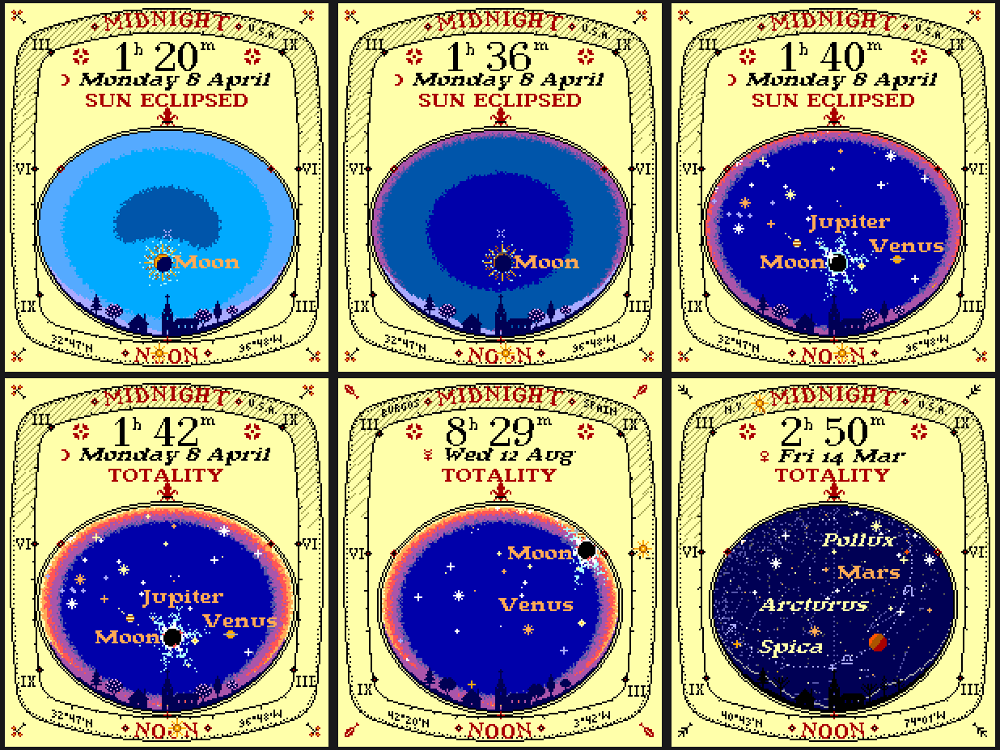

### The weather

With the weather, the face shows the place's own sky, drawn as an engraver would draw it. On the watch the phone fetches it from Open-Meteo, which needs no key.

- **The temperature** follows the Sun's rising or setting, set off by a lozenge: 61°, its degree sign raised like the ʰ and ᵐ. The sign came into thermometry in the 1770s. Fahrenheit or Celsius, as the phone is set.
- **Clouds** drift across the window downwind while the stars turn beneath them. They take Luke Howard's three forms (1803):
  - cumulus heaps, flattening into banks as they thicken;
  - the stratus sheet in ruled lines, as the engravers drew it;
  - cirrus in single hair strokes.

  By day the clouds are white with grey bases. At sunset their undersides light rose and gold. At night they are dark, edged with silver, brighter under the Moon.
- **Weather by subtraction.** Haze and cloud take the faintest stars first, then the Milky Way. Behind a heap nothing shows; through the stratus only the brightest stars. Under a closed sky the day goes an even grey, whiter in fog and darker under rain.
- **Rain** falls in fine lines of two tones, leaning with the wind, as Hiroshige cut it. **Snow** falls in soft pecked flakes, never a star's cross.
- **The halo.** Thin high cloud rings the Moon (by day the Sun) at 22 degrees. The ring is drawn in the chart's own projection, so it stretches as the chart does.
- **Fog** lies over the hills in three ruled lines, and the village fades to a ghost of itself.
- **The village reports the weather too:**
  - the church's vane points into the wind;
  - smoke rises from the house's chimney on a cold day and leans downwind;
  - snow lies on every roof, treetop and hilltop.

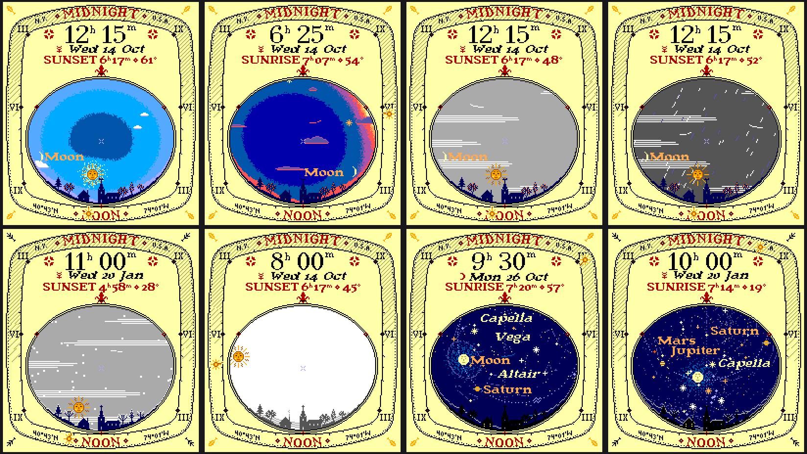

### The distant hills

Behind the village, low distant hills stand along the horizon in one quiet tone that takes the hour's light:
- pale with the haze by day;
- gold, then rose, then the mauve of the afterglow as the Sun goes down;
- by night a dark cutout where the stars stop, its ridge faintly silvered.

They are lost in fog and falling rain or snow, and go grey under a closed sky. On the printed charts only their ridge is drawn, engraved.

The hills can be the place's own. From the terrain (Open-Meteo's elevation service, the Copernicus 90 m model, no key), the skyline is worked out once for the place, every two degrees across the window's southern edge:
- Along each bearing the ground is sampled from 5 to 140 km out. The nearer ground is skipped, because the model includes buildings and woods.
- The skyline's height is the steepest angle up to any of that ground, with the Earth's curve taken off and the air's refraction put back.
- It is kept as quiet as the drawn hills: gentle country is magnified at most twice, and big mountains are brought down to the same low band.
- Where the land is flat, as round New York, the drawn hills stand in.

On the watch the phone would do the survey once for each new place and keep the result.

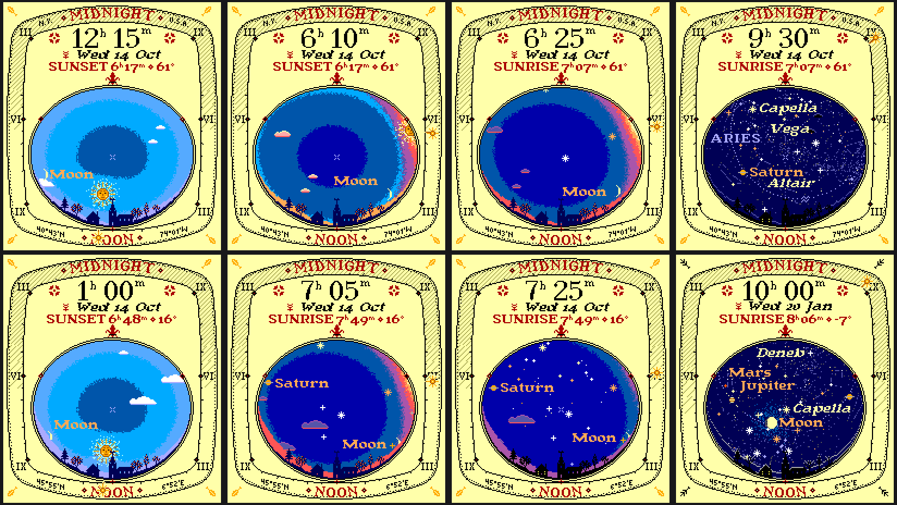

### The year

The village keeps the year, as an almanac's cuts of the months do. The season comes from the Sun's place in the zodiac, turned half a year for the southern hemisphere.
- The trees come into blossom in April, stand in full leaf through the summer, turn gold in October and stand bare through the winter. The firs stay green.
- The house's windows are lit of an evening.
- The Time 2's corner sprigs follow the season.


And the filigree, all drawn by hand:

- on the southern horizon, a church and a house among trees, after the cuts of a village on an almanac's page. The church stands at the south point, its spire on the meridian and a weather vane on its mast. Each piece is drawn whole and stood on the ground along the window's lower edge: a tree where its trunk meets the ground, a building as low as the ground under it goes. Behind them low distant hills catch the light (below). They keep the season and the weather;
- the engraver's glory of fine rays round the Sun on the printed charts;
- a beaded rule inside the ring's outer rule, as on a clock's chapter ring;
- studs on the inner rule at the numbered hours;
- a star at the south point, clasping the window's two rules, to go with the fleur-de-lis at the north and the lozenges east and west;
- a sprig turning into each of the Time 2's corners, in the season's dress;
- a printer's flower either side of the time, as a title is set off: the small broken lozenge from Peter Quentel's pattern book (*Eyn New Kunstlich Boich*, Cologne, 1529), stitch for stitch. Charted needlework is the period's own pixel art. Each flower stands midway between the ring and the widest the time can be, so it stays put as the minutes change;
- a face on the full Moon, as the almanacs give it.

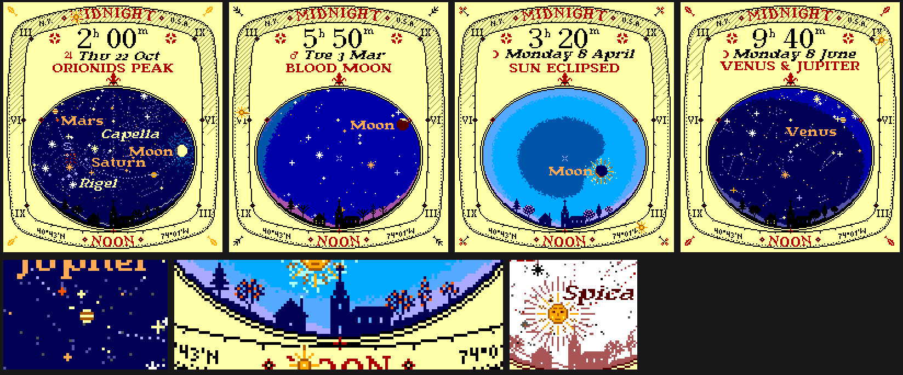

## Animations

Each plays for a moment, then the face is still again: a watch has no battery for more.

- **Falling stars.** Now and then at night a meteor streaks across the window, its head a small cross of white, its trail fading through cream and grey into the sky. On a shower's peak night they come often, and all streak out from the shower's radiant.
- **Birds.** Now and then by day a little flock crosses the sky in a loose V, wings beating, in the village's dark ink.
- **The village.** The hour and the season bring their own passers-by:
  - swallows hawking low over the fields on summer mornings, swooping round the church tower;
  - on a mild evening, a bat dropping out of the belfry and flitting over the roofs;
  - by night the owl on the church's ridge, blinking its gold eyes and looking east and west, with fireflies flashing among the trees on warm summer nights;
  - in autumn, leaves loosed from the trees, tumbling downwind to the ground, and geese going south in a long V;
  - in winter, jackdaws wheeling round the church tower.
- **The weather.** Rain and snow fall, the clouds drift downwind and the chimney smoke rises.
- **The hour.** At the top of each hour, one of two animations, as you choose:
  - **The constellations** (the default). The figures in the window are traced one by one, without their names, each over a second. A cream line runs star to star like an engraver's pen, with its tip white, and each star flashes as the line reaches it. The figure holds a moment, then fades back as the next begins. Those that came into the window during the hour go first, east to west, then the highest in the sky; five at most. By day the figures that are up behind the blue are sketched faintly in white, then fade.
  - **The turn.** The star disc spins through a whole day in a few seconds, then settles back to now, as a planisphere turns in the hand. The window races from night through dawn, the day and dusk, while the Sun's pointer sweeps round the ring. The clock keeps its time throughout.

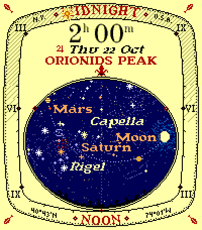

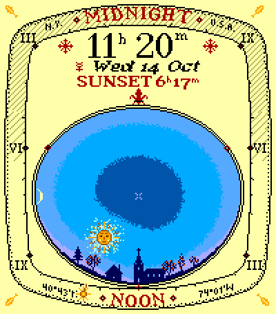

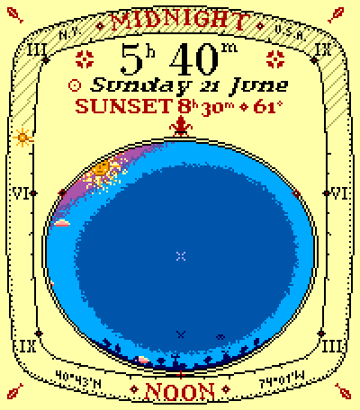

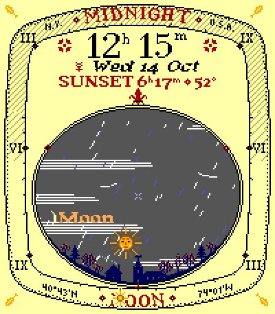

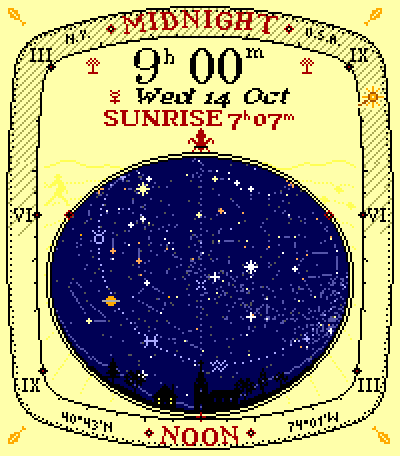

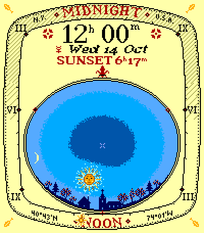

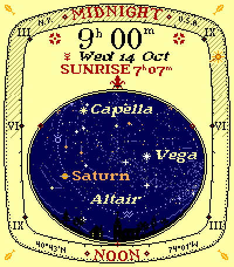

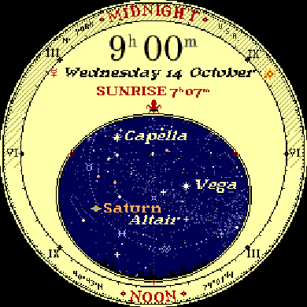

## Experimental: the compass, on a flick

Off unless you turn it on, as an experimental setting. The magnetometer costs battery while it runs, so it only runs when you ask. Flick your wrist and the compass turns on for half a minute. The face becomes a window onto the sky where the watch points: the horizon along the bottom, the compass points on it, and names on what is bright. Then the compass switches off and the planisphere comes back; a second flick ends it sooner.

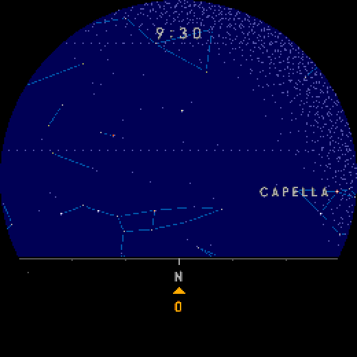

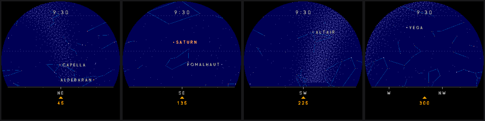

## Earlier takes

### A round ring on the Time 2

Before the cushion, the Time 2 had the Round 2's circular ring, with a woodcut texture in the corners (rays, stars or hatching) and nothing there to read. The circle made the window smaller.

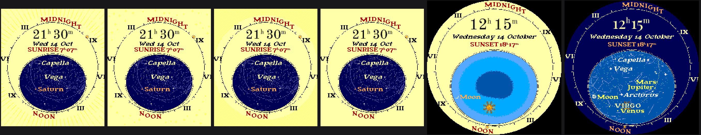

### The readable version

The time is large above the window, with the date and the Sun's next rising or setting. The sky names what is bright in it: the Moon, the planets, and the brightest stars in view.

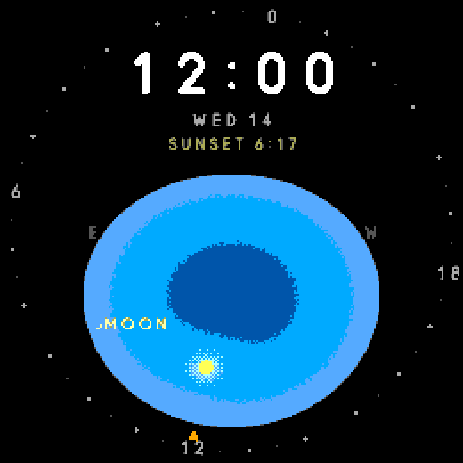

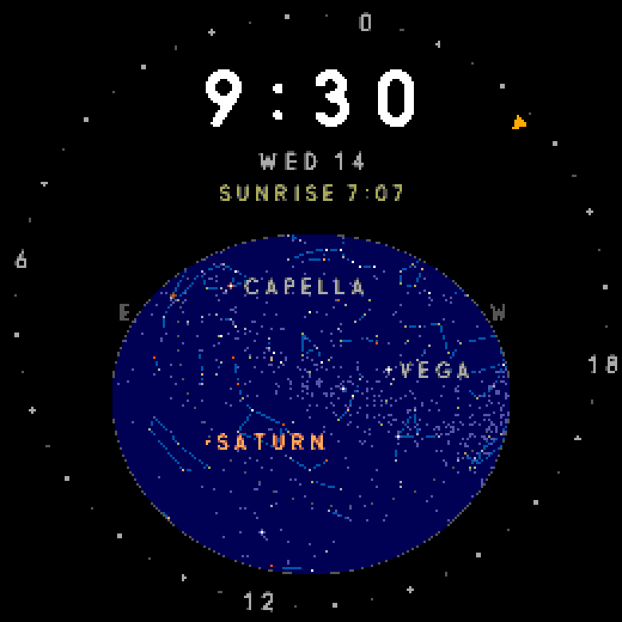

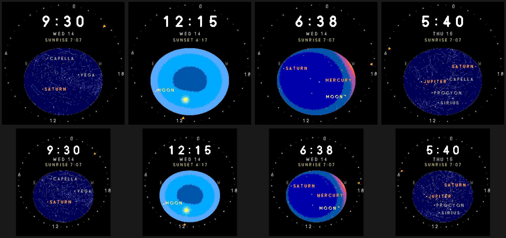

### The instrument version

The first take, before readability: no clock, only the planisphere. The Sun's golden pointer on the 24-hour ring is the only way to read the time.

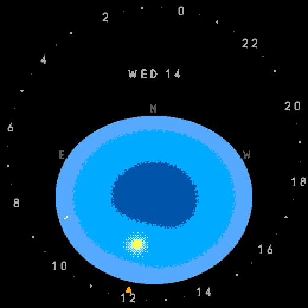

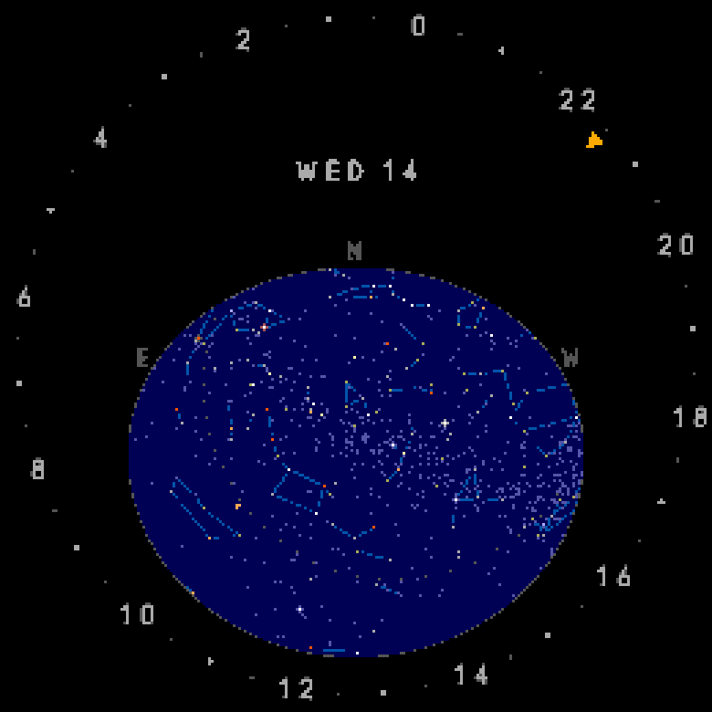

## How the planisphere works

- **The star disc** is the whole sky as a planisphere draws it: the celestial pole at the centre, the stars round it, turning once a sidereal day as the real sky does.
- **The window** is your horizon. The black jacket hides everything below it, so the oval shows exactly the sky above you now (here, New York; east is on the left, as when you look up).
- **The Sun is the hour hand.** It rides the ecliptic through the sky, and the gilded Sun hand on the ring follows it. Paper planispheres had no moving marker: you turned the star disc until the date on its rim met the time. Astrolabes read the hour with a straight rule laid over the Sun's place. Astronomical clocks carried a gilded Sun round a 24-hour ring, which is what this ring is. The ring keeps the Sun's own time, as a sundial does: NOON under the window's south point and MIDNIGHT above the pole, fixed, so the pointer reaches NOON as the Sun crosses the south (12:42 by the clock in New York in October). The large numerals keep the clock's time.
- **The sky's colour is the real sky's**, from the Sun's height and direction: flat night blue with the Milky Way, the blue hour with a warm glow on the Sun's side, day blue with the Sun in it. The colours come in clean bands along the sky's own contours, each edge softened by a fine dither.
- About 1,000 stars, down to magnitude 4.6, in their own colours. The figures are drawn only between the brighter stars, and stop just short of them. The Moon shows its true phase, lit from the Sun's side, and the five bright planets are there too.

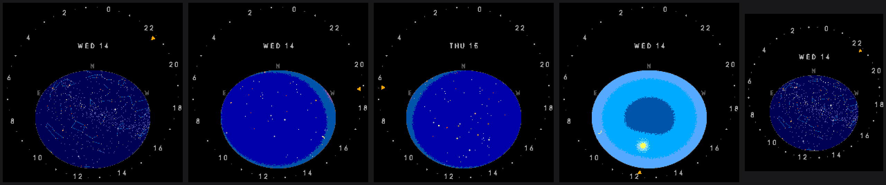

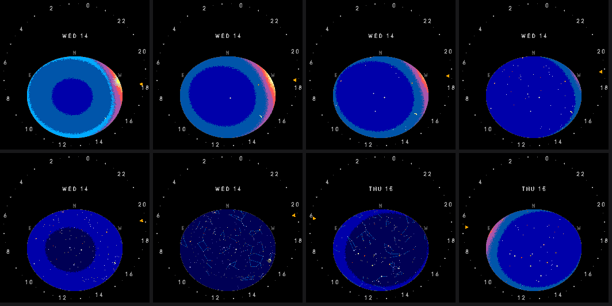

## How it is drawn

Every image above is drawn at the watch's own size (260×260 round, 200×228) in its 64 colours (two bits a channel), so what you see is what the watch can show. The lines and edges are kept to whole palette colours, and the only dithered texture at night is the Milky Way, as blue-noise grain.

The pieces are drawn by hand, pixel by pixel, not generated from shapes. Each is kept as text art in `proto/sprites.py`:

- **The Sun** has a face and sixteen rays. One eighth of the rays is drawn and turned round the circle, so they are exactly symmetric.
- **The Moon** goes through its phases across the month. The terminator curves as on the real Moon, so a crescent thins to points at its horns. The dark part carries the engraver's hatching.
- **The stars** are drawn by brightness: eight points, four, a cross, a point.
- **The planets** each have a little picture: Saturn's ring, Jupiter's bands.
- **The ornaments** are:
  - the fleur-de-lis standing on the window at the north, the lozenges and the south star;
  - the studs;
  - the corner sprigs through the year;
  - Quentel's flowers beside the time;
  - the engraved glory;
  - the village on the horizon.
- **The distant hills** are drawn as straight ridges between hand-placed points: a long ridge rising to a summit on either side, with the steeple against the sky between.
- **The village** is a church (tower, pinnacles, tall spire, nave with lancet windows), a two-storey house with a chimney, and trees: a broad tree, a poplar and a small tree, each in leaf, blossom, turning, gold and bare, and a fir. The church's vane is drawn three ways. Its passers-by are drawn too: a swallow, a bat and a jackdaw on the wing, the owl blinking and looking about, a tumbling leaf, a firefly's flash.
- **The clouds** are Howard's: cumulus heaps and banks drawn as silhouettes, whose tops and bases the face lights for the hour, and cirrus in hair strokes.
- **The almanac's signs** are the zodiac and the planets that rule the days.
- **The ring's hours** are hand-drawn too: roman numerals on the 12-hour clock, figures on the 24-hour clock.
- **The large time** is drawn by hand for each plate's type and each watch:
  - modern scientific figures after Old Standard, with ball terminals and a flagged 1;
  - an engraver's copperplate Didone for Burritt;
  - Caslon's old-style figures for Flamsteed, with 3 4 5 7 9 below the line.

  The Round 2's figures are the Time 2's, grown along their straight runs.
- **MIDNIGHT and NOON** are roman capitals with thick stems, thin hairlines and serifs. Each letter is drawn turned to its own place on each screen's ring, its stems stepping and its bars sloping as the curve turns.

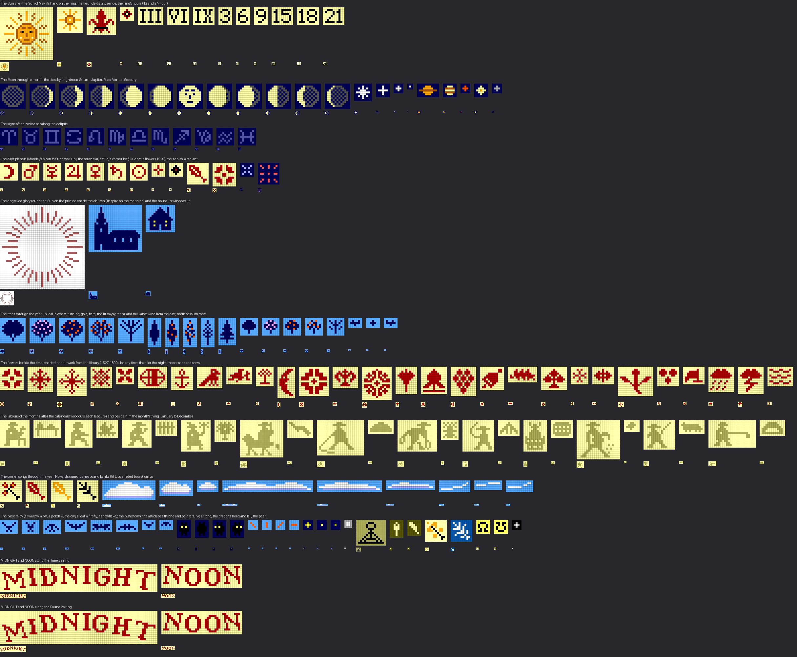

- `proto/astro.py`: sidereal time and the planets, from Paul Schlyter's orbital elements (well under a pixel at this scale); `proto/lunar.py`: the Sun and the Moon from Meeus, closely enough for eclipses.
- `proto/plates.py`: the plates (the current design): the projection, the window as the horizon for your latitude, the sky's colour bands, and the ring.
- `proto/frame.py`: the Time 2's cushion, with exact distances to its edge, so the rules, ticks and lettering run along true parallels of it.
- `proto/events.py`: Jupiter's moons, eclipses, planets meeting and the meteor showers, for the almanac.
- `proto/sprites.py`: the hand-drawn pieces; `proto/letterer.py` and `proto/coverage.py`: the drafting table the curved words were drawn from; `proto/closeup.py`: close-ups of the faces, pixel by pixel, for checking.
- `proto/figures.py`: the large time's hand-drawn figures; `proto/foundry.py`: the drafting table they were drawn from; `proto/typeset.py`: the typefaces they follow (and the large time where no figures are drawn); `proto/pixeltext.py`: the pixel type.
- `proto/weather.py`: the weather as the phone would fetch it, Howard's sky from it, and the barometer's and thermometer's words; `proto/skies.py`: the clouds, rain, snow and halo drawn into the window.
- `proto/horizon.py`: the place's own skyline from the terrain, kept in `data/horizons/`.
- `proto/look.py`: the compass view; `proto/animate.py`: the animations and their films.
- `proto/film_plates.py`: the plates' films and stills; `proto/film.py`, `proto/film_readable.py`: the earlier takes' (`proto/render2.py` draws those).

```
uv run python proto/film_plates.py      # writes docs/
```

Next: the same drawing in C for the watch, with the pieces and the stars as small tables.

## Credits

Star positions and colours, constellation lines and the Milky Way's outline come from [d3-celestial](https://github.com/ofrohn/d3-celestial), © 2015 Olaf Frohn, BSD 3-Clause (`data/`). The numerals use the monoline stroke font made for Morphogen 9.

Quentel's flower is transcribed from *Eyn New Kunstlich Boich* (Peter Quentel, Cologne, 1529) in the Metropolitan Museum of Art's Open Access collection (CC0, 20.50.2).

Pixel type: Not Jam Old Style 11 by Not Jam (CC0, `fonts/pixel/`). Type: Old Standard TT (Alexey Kryukov), Libre Caslon Text, Playfair Display, with IM Fell, EB Garamond and Cinzel tried in [the type specimen](docs/type-specimen.png). All are SIL Open Font License 1.1, and the licences are in `fonts/`.
